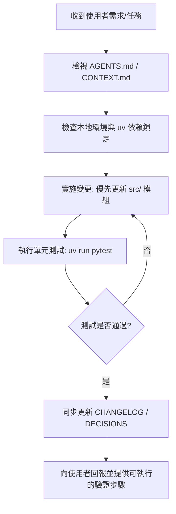

# AGENTS.md - AI 協同協作與維護規範

本文件旨在規範所有參與本專案開發、除錯、測試與演進之 AI 代理人（包含 Google Antigravity、OpenClaw、Claude Code、Cursor 等）的行為準則與操作協定。

---

## 1. 專案背景與定位 (Project Context)
本專案為 **國立東華大學 (NDHU) 課程加退選自動化與預排檢視系統**。
系統核心以 Python Playwright 驅動真實 Chrome 瀏覽器，自動完成登入、教學意見彈窗解除、預排課程名額探查，並透過本機 `courses_info.md` 提供人性化優先級排程，於選課開放瞬間以極限擬真手速執行加選。

---

## 2. Agent 角色定義與職責劃分

### 🤖 核心架構師 Agent (System Architect)
- **職責**：維護 `src-layout` 模組化邊界（`core/`, `tools/`），制定版本相容性原則，維護 ADR 決策記錄。
- **邊界限制**：非經使用者允許，不得破壞向後相容進入點（`auto_login.py` 與 `main.py`）。

### 🛡️ 安全合規 Agent (Security & Privacy Guardian)
- **職責**：監控憑證安全。
- **強制規範**：
  - 嚴格禁止將任何真實帳號、學生證號碼（如 `411383***`）、明文密碼寫入 git 追蹤檔案或公開文檔中。
  - 確保所有真實設定檔（`config.txt`, `.env`）維持在 `.gitignore` 排除名單內。
  - 對外範例文檔一律使用 `.env.example`。

### ⚡ 效能與自動化 Agent (Performance & Playwright Specialist)
- **職責**：調校瀏覽器等待邏輯、網路監聽器與 PostBack 反應延遲。
- **設計準則**：
  - 登入與表格查詢階段求「穩」：維持必要的 DOM 渲染與 `networkidle` 等待。
  - 搶課加選階段求「快」：維持 20ms~50ms 擬真人流微延遲，不得隨意增加阻塞型 `sleep`。

### 🧪 測試與驗證 Agent (Quality Assurance)
- **職責**：維護單元測試與功能測試。
- **測試規範**：
  - 所有解析器（如 `courses_info.md` 表格讀取）均需具備離線單元測試（`tests/`）。
  - 對於需要真實登入的搶課流程，必須支援離峰「乾跑演練」（Dry-run）模式，即使加選按鈕尚未出現亦不可崩潰。

---

## 3. 協同工作流標準流程 (Agent Workflow Protocol)

### 必守原則：
1. **依賴管理**：一律使用 `uv add` 或 `uv sync`，禁止使用全域 pip 安裝套件。
2. **無頭模式限制**：除非使用者明確要求無介面背景測試，預設務必維持 `headless=False` 與 `channel="chrome"`，保證使用者能在螢幕上看見完整操作。
3. **對話追溯義務**：若有重大設計變更或新功能上線，應將歷程同步更新至 `CHANGELOG.md` 並記錄至 `DECISIONS.md`。
