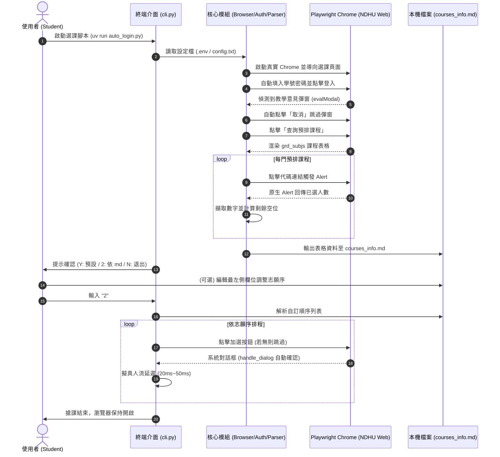

# 系統架構與服務架構圖 (ARCHITECTURE.md)

本文件詳述 **NDHU Course Selector (東華大學自動選課與預排檢視系統)** 的系統架構設計、核心模組職責與循序互動流程。

---

## 1. 模組分層架構 (src-layout)

```text
src/ndhu_course_selector/
├── __init__.py           # 套件導出介面
├── cli.py                # 終端流程整合主控台
├── core/                 # 核心業務與瀏覽器交互
│   ├── auth.py           # ASP.NET 登入與 evalModal 對話框解除
│   ├── browser.py        # Playwright Chrome 實體與原生 Alert 監聽器
│   ├── parser.py         # grd_subjs 表格爬取、人數提取與 Markdown 雙向同步
│   └── selector.py       # 自訂志願序排程加選與電競擬真微延遲
└── tools/                # 底層輔助工具
    └── config.py         # .env / config.txt 憑證解析器
```

---

## 2. 系統互動循序圖 (Sequence Diagram)



---

## 3. 關鍵設計原則 (Key Design Principles)
- **非同步事件轉化同步直覺**：Playwright Sync API 提供平順的命令列互動體驗，避免過度複雜的 Async Event Loop 爭用。
- **降級容錯 (Graceful Degradation)**：任何單一課程在提取人數或加選時失敗，均不中斷整體主流程。
- **外部人機互動界面**：將 Markdown 檔案作為 GUI 的輕量級替代方案，兼顧簡單、透明與版本可追溯性。
