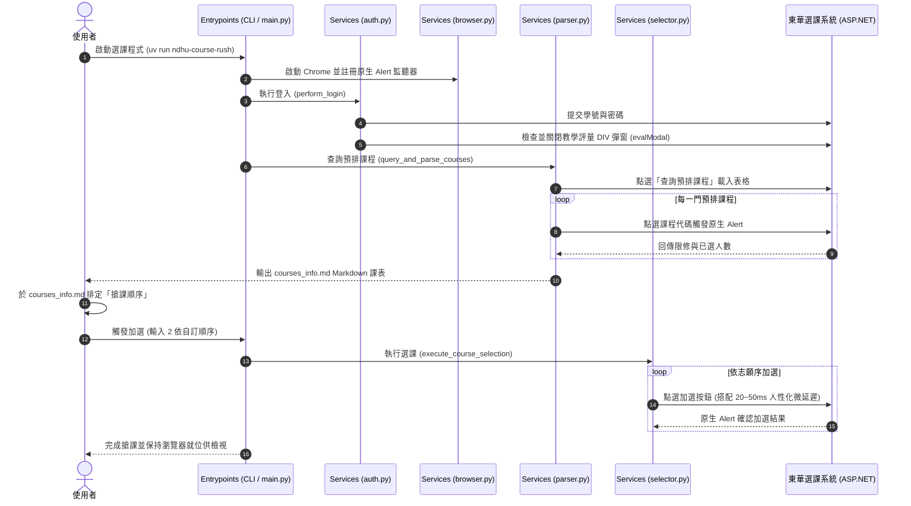

# 系統架構 (Architecture)

> 手動維護本檔的「系統概覽」；以下報告由工具自動產生，請勿手動修改。

| 文件 | 內容 | 產生方式 |
|---|---|---|
| [`PROJECT_TREE.md`](PROJECT_TREE.md) | 完整目錄樹 | `agentctl sync` / 每次 commit |
| `GRAPH_REPORT.md` | 模組依賴圖、分層檢查、函式大小 | 需要時 `agentctl graph`（不進 git） |
| `AGENT_AUDIT_REPORT.md` | 各 Agent 的 commit 與任務 | 需要時 `agentctl audit`（不進 git） |

## 系統概覽

**NDHU Course Rush** 是一套以 Microsoft Playwright 驅動原生 Chrome 瀏覽器的國立東華大學自動化選課與預排課程檢視系統。
系統透過單向分層架構，自動化處理憑證登入、教學評量彈窗解除、預排課表抓取、名額空位即時計算、`courses_info.md` 雙向同步以及自訂志願序極速加選。

## 分層

見 `.agents/project.toml` 的 `[architecture] layers` 與 [`ARCHITECTURE_RULES.md`](../standards/ARCHITECTURE_RULES.md)。
- **entrypoints**: `cli.py` 與 `main.py`
- **adapters**: 外部整合
- **services**: `auth.py`, `browser.py`, `parser.py`, `selector.py`
- **domain**: `Course`, `CoursePriority`
- **config**: `AppConfig`, `settings.py`, `legacy_config.py`
